# Fog City TV

**A simulated smart TV in your browser, with four channels for San Francisco:** a 1990s-style weather station, a public-domain art gallery, a never-ending fireplace, and Fog City Talk, where you talk to Claude and it runs the TV.

### [Play it now: az9713.github.io/fog-city-tv](https://az9713.github.io/fog-city-tv/)

Press **Enter** (or click the screen) to power on, then **F** for full screen. Turn your sound on.

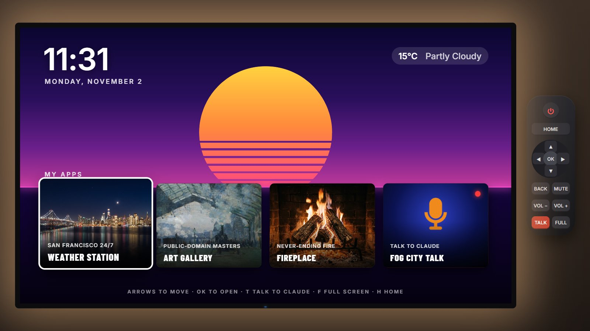

> **Inspiration:** [Tristen O'Brien's video](https://www.youtube.com/watch?v=-heT5C0oPg0) on building custom Android TV channels with Claude. Fog City TV recreates the idea for anyone with a web browser, with no TV hardware needed. All code, branding, music and media here are original.

---

## The channels

### Fog City Weather Station

Live National Weather Service data in Celsius, presented like 1990s cable weather. It has an animated Doppler radar, pixel-art icons, a scrolling crawl, generative smooth jazz and a spoken announcer.

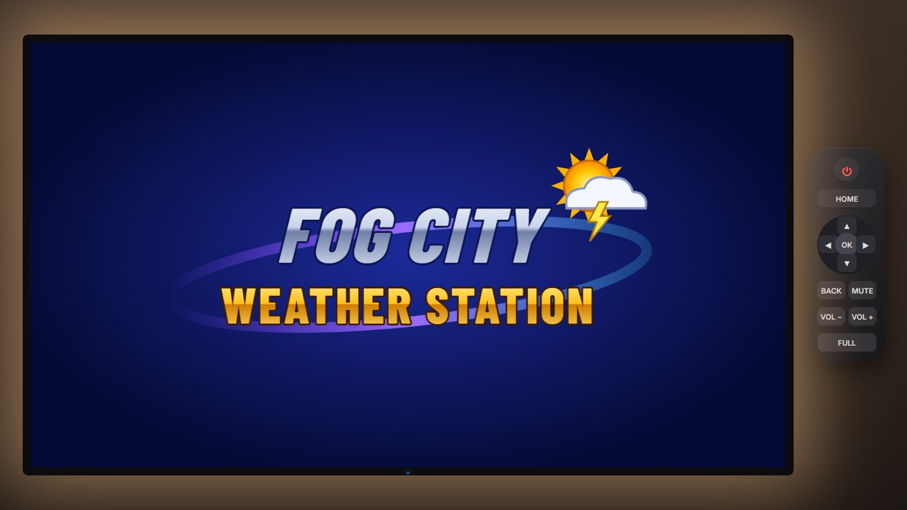

| Current conditions | Weather alert |
|---|---|
| 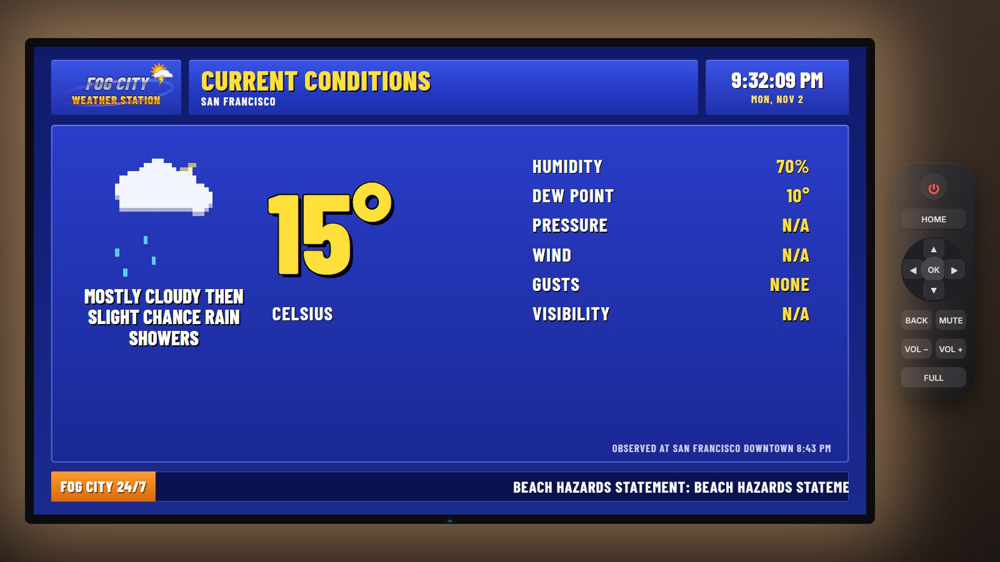 | 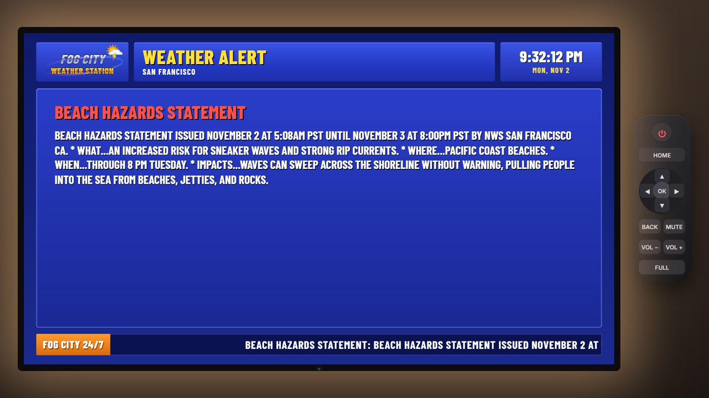 |

| Local Doppler radar | Local forecast |
|---|---|
| 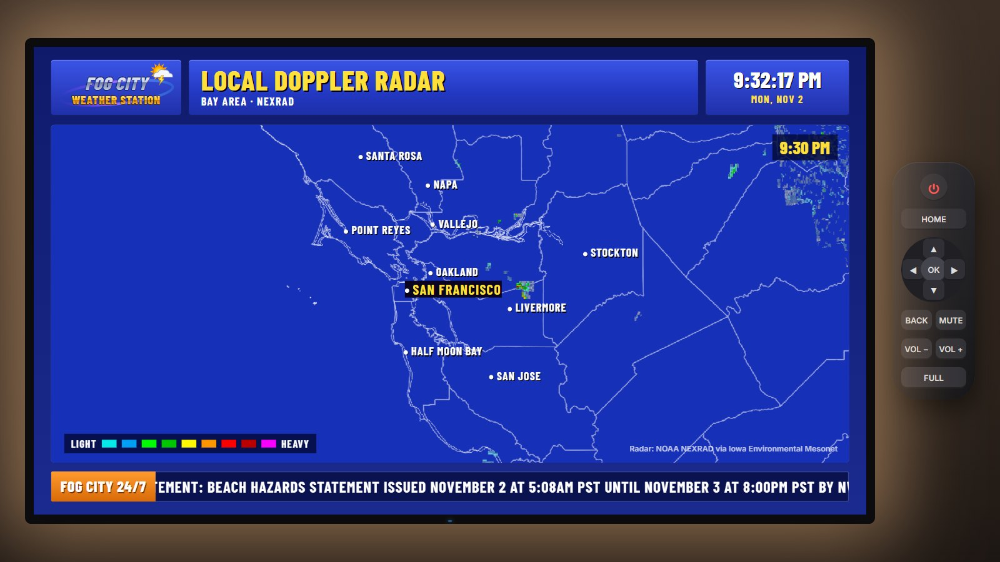 | 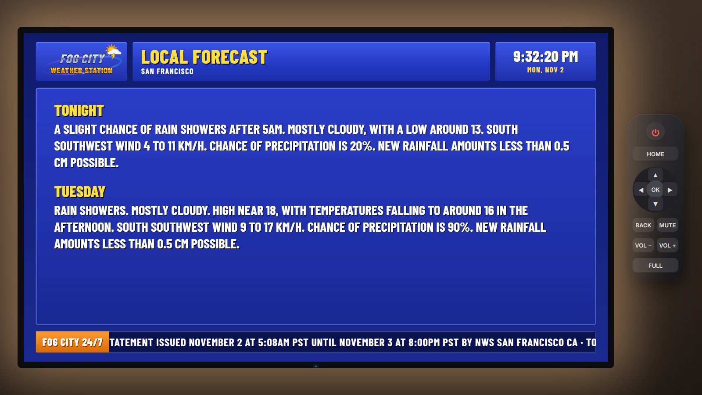 |

| Extended forecast | Fog City Sky Cam |
|---|---|
| 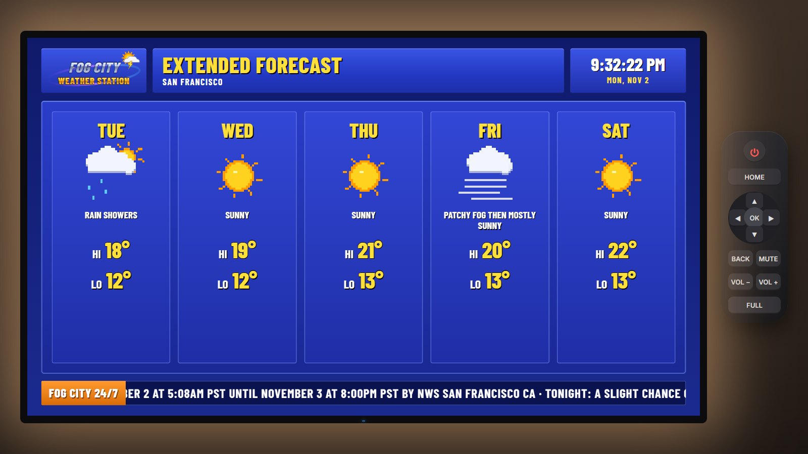 | 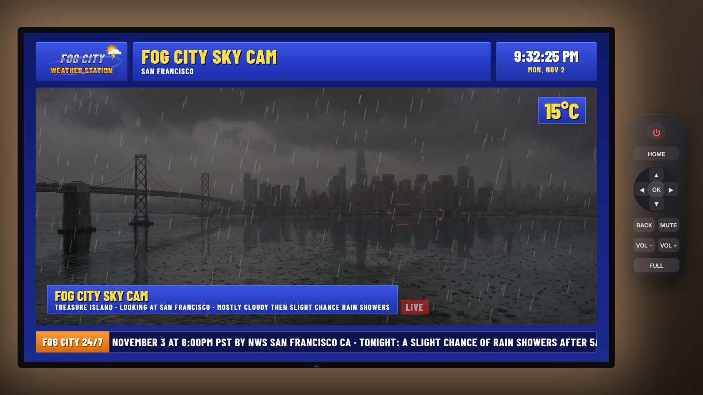 |

The sky cam switches between six photoreal views of the same skyline (sunny, overcast, fog, rain, storm and night) to match the live conditions. It adds animated rain or fog and lightning flashes on top.

### Never-Ending Fireplace

A photoreal 10-second fire loop made with Kling 3.0. The clip ends on exactly the frame it starts with, and two video players crossfade so you never see the seam. The crackling is synthesized live and never repeats. There is also a sleep timer that fades the fire out and switches the TV off.

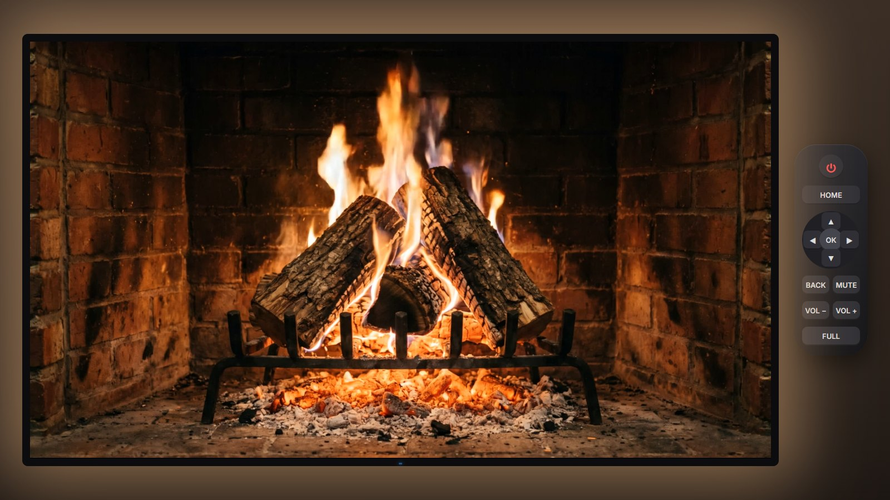

| With remote hint | Sleep timer |
|---|---|
| 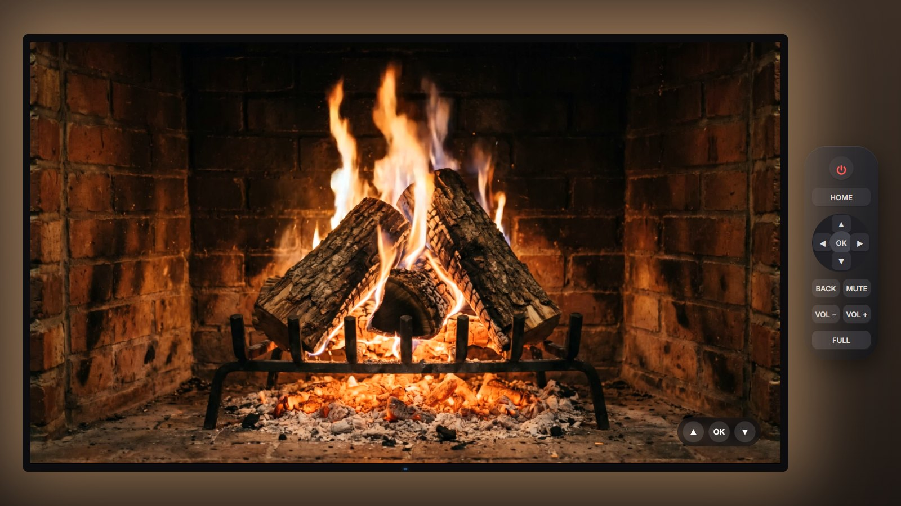 | 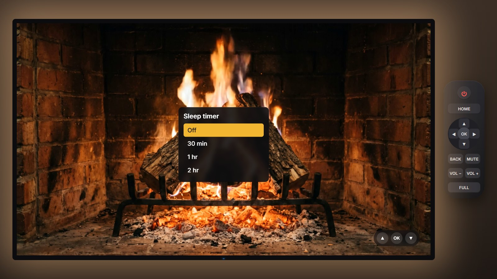 |

### Art Gallery

Public-domain paintings from the Art Institute of Chicago in a matted frame. It offers seasonal and themed collections, 9 mat colours and 5 mat sizes, captions, and automatic dimming after sunset.

| Gallery | Mat menu |
|---|---|
| 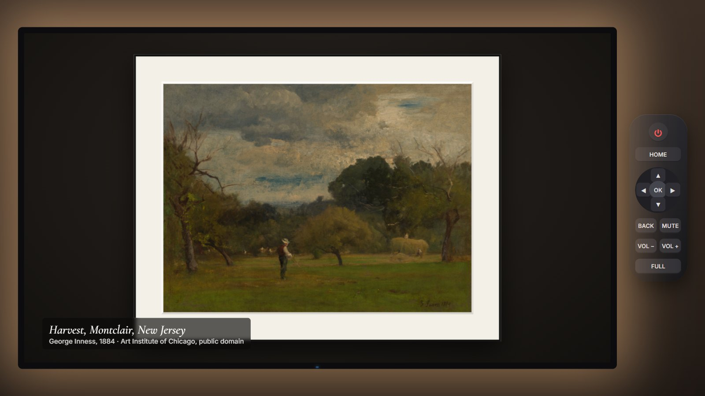 | 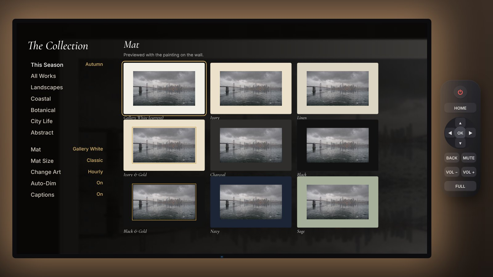 |

### Fog City Talk

Talk to Claude by voice or keyboard on any channel: press **T**. It answers on screen and out loud, and it can run the TV. It switches channels, sets the fireplace sleep timer, finds paintings, changes the volume, reads the live forecast and searches the web.

| "What should I wear today?" | "Show me some Monet" |
|---|---|
| 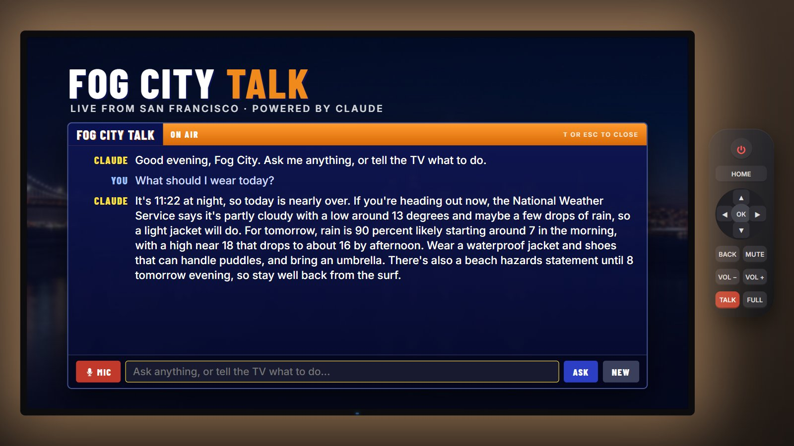 | 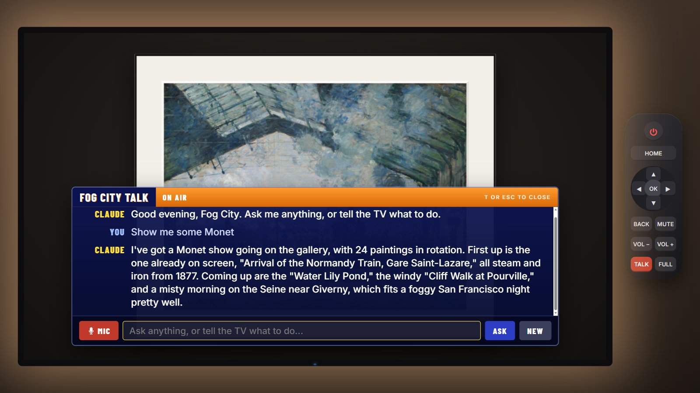 |

| "Put on the fireplace with a 30 minute sleep timer" | "Where can I stream The Bear?" |
|---|---|
| 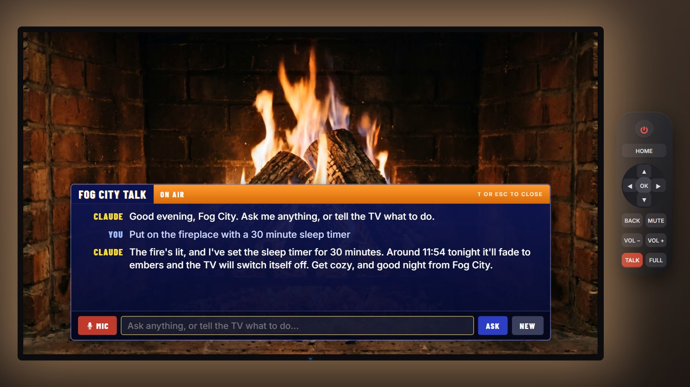 | 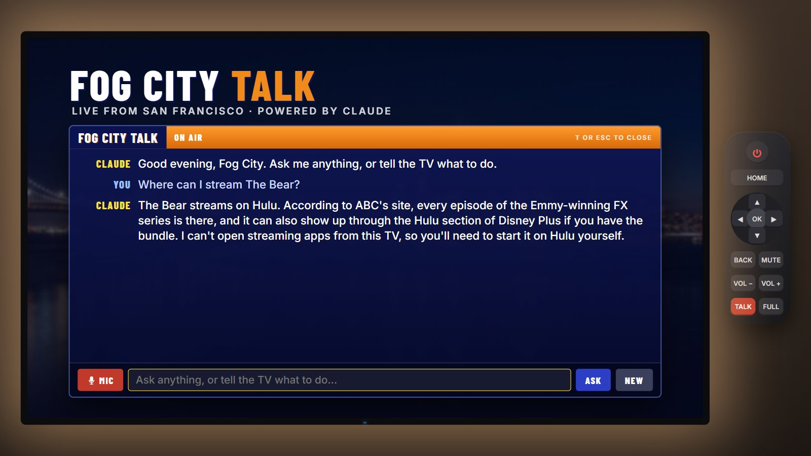 |

These are real answers from Claude, captured on the laptop. How the channel works inside (the API request, the proxy, tool use, web search and voice) is in [docs/JOURNEY.md, section 10](docs/JOURNEY.md#10-fog-city-talk-how-the-claude-channel-works).

This channel uses the paid Claude API, so it needs your own API key. The key stays in a small proxy and is never in the page or this repo. On the public site the channel stays **off the air** unless you connect your own proxy. Setup, security and cost (under 2 cents for a TV command, about 7 cents for a question that needs a web search) are in **[docs/CLAUDE-CHANNEL.md](docs/CLAUDE-CHANNEL.md)**.

---

## Can it be played from this README?

Not inside the README itself, because GitHub doesn't run scripts in Markdown. The repo is published with **GitHub Pages**, so the **[Play link](https://az9713.github.io/fog-city-tv/)** above opens the full working TV in one click. Nothing to install.

## Run it locally (Windows, macOS, Linux)

The page uses JavaScript modules, so it must be served over http. Opening `index.html` directly won't work.

```bash
git clone https://github.com/az9713/fog-city-tv
cd fog-city-tv
python -m http.server 8080      # or: npx serve -l 8080
```

Then open http://localhost:8080. On Windows you can also double-click **`start.bat`**, which runs `python server.py` (the same site plus the Claude proxy for Fog City Talk) and opens the browser. Every channel except Fog City Talk works with any static server.

**Requirements:** a modern browser (Chrome or Edge recommended, Firefox works), Python 3 or Node.js for the local server, and an internet connection for live data. If you're offline, the TV still runs with labelled sample weather and a local photo gallery. See the [journey report](docs/JOURNEY.md#9-requirements-and-dependencies-on-windows) for the full Windows setup.

## Remote control

The on-screen remote and the keyboard do the same things.

| Key | Action |
|---|---|
| Enter / Space | Power on, OK, select |
| Arrow keys | Navigate. In Weather, step through segments. In Fireplace, set the crackle level. In Gallery, change the painting. |
| Esc / Backspace | Back |
| H | Home |
| P | Power |
| M | Mute |
| + / - | Volume |
| T | Talk to Claude (Fog City Talk) |
| F | Full screen |

In the Fireplace and Gallery, **OK** opens that channel's menu.

## How it's built

- Plain HTML, CSS and JavaScript ES modules: no framework, no build step and no runtime dependencies. Only Fog City Talk needs an API key, and that key stays in the proxy (`server.py` or `worker/worker.js`).
- **Data:**
  - [NWS api.weather.gov](https://www.weather.gov/documentation/services-web-api): observations, forecast and alerts.
  - [Iowa Environmental Mesonet](https://mesonet.agron.iastate.edu/) NEXRAD tiles: radar and base map.
  - [Art Institute of Chicago API](https://api.artic.edu/docs/): public-domain (CC0) works only.
- **Sound:** everything is synthesized with the Web Audio API: an FM electric piano, walking bass and brushes for the jazz, and Poisson-process crackles for the fire. The announcer uses the browser's speech synthesis.
- **Media:** the photoreal sky cam and fireplace were generated once with [fal](https://fal.ai) (Nano Banana Pro and Kling 3.0 Pro) for **about $3.10 in total**.

The whole story is in **[docs/JOURNEY.md](docs/JOURNEY.md)**. It covers the APIs, open-source resources, how the radar map and every graphic were made, the fireplace loop, fal prompts and costs, the bugs found in live testing, and the Windows requirements.

## Tests

```bash
npm i -D playwright && npx playwright install chromium
python -m http.server 8765 &      # from the repo root
node tests/run.js mock            # mocked NWS, radar and museum data
node tests/run.js offline         # all external hosts blocked
```

## Credits

- Inspiration: [Tristen O'Brien](https://www.youtube.com/watch?v=-heT5C0oPg0).
- Weather data: NOAA / National Weather Service (public domain). Not affiliated with or endorsed by NWS.
- Radar: NOAA NEXRAD via the Iowa Environmental Mesonet, Iowa State University.
- Paintings: Art Institute of Chicago, public-domain works (CC0).
- Fonts: Barlow Condensed, Cormorant Garamond and Inter (SIL Open Font License).
- Generated media: Nano Banana Pro and Kling 3.0 Pro via fal.
- Built with [Claude Code](https://claude.com/claude-code).

## License

The code is under the MIT License (see [LICENSE](LICENSE)). The generated images and video in `assets/` may be reused with this project. Third-party data and artworks remain under their own terms, listed above.
