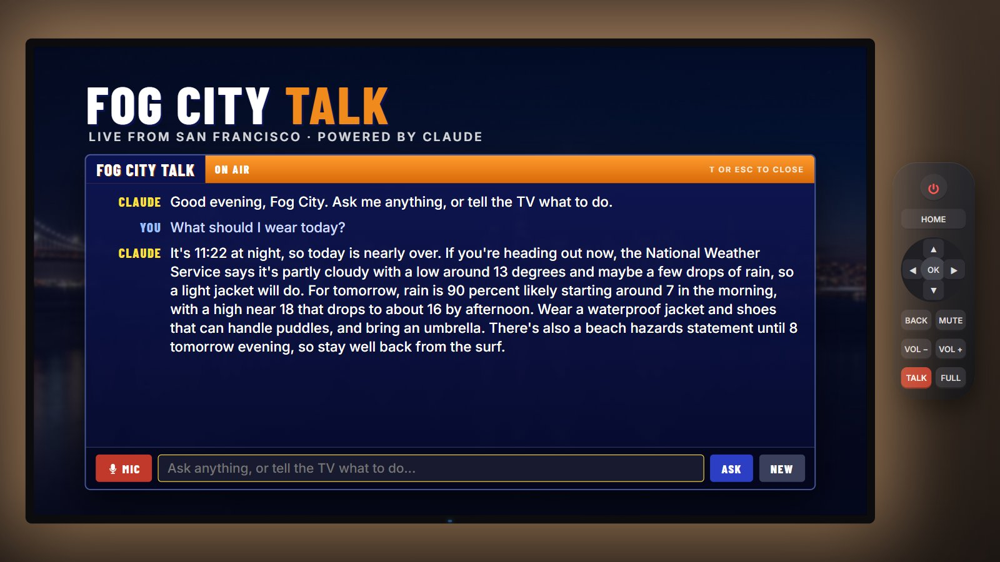

# Fog City Talk: the Claude channel

Fog City Talk is a TV channel where you talk to Claude. Press **T** (or the red **TALK** button on the remote) on any channel, or open the **Fog City Talk** tile on the home screen. Speak with the **MIC** button (Chrome or Edge) or type, and Claude answers on screen and out loud.

It uses the **Claude API**, which is separate from the Claude chat app and from Claude Code. Each question is a paid API call, billed to the API key you set up below.



## What it can do

| Ask | What happens |
|---|---|
| "What should I wear today?" | Claude reads the live NWS forecast and answers |
| "Put on the fireplace with a 30 minute sleep timer" | Switches to the fireplace and sets the timer |
| "Show me some Monet" | Opens the gallery on matching public-domain paintings |
| "Who painted this?" (on the gallery) | Claude knows which painting is on screen |
| "Read me the Fog City bulletin" | About 45 seconds of weather plus a few headlines from a web search |
| "Where can I stream The Bear?" | Web search, then names the service |
| "Turn it down to 30" | Sets the volume |

Claude drives the TV through five tools defined in `js/talk.js`: `switch_channel`, `set_sleep_timer`, `show_art`, `set_volume` and `get_forecast`. Web search runs on Anthropic's side.

## How the key stays secret

The API key is never in the page or in this repository. The page talks to a small proxy that adds the key:

```
browser (js/talk.js) --> proxy --> api.anthropic.com
                         |
                         +-- laptop: server.py reads .anthropic_key (git-ignored)
                         +-- public site: Cloudflare Worker with the key as a secret
```

The proxy, not the page, fixes the model (`claude-opus-5-5`), the effort (`low`, for quick spoken answers), the 2,048-token answer cap and the tool list. It also stops after a daily number of requests. So a modified page can't make it run a pricier model or bigger requests.

Visitors to the public site can't spend your credit:

- If `js/config.js` has no proxy address, the channel shows **Off the air** and makes no calls. That's how the repo ships.
- The Worker only answers requests from your site's address and asks for a passcode. You type the passcode once per device, and it's saved in that browser.
- The Worker stops at a daily request limit, and the Console spend limit stops everything at a dollar cap.

## Step 1: create the API key (everyone)

1. Sign in at [platform.claude.com](https://platform.claude.com) with the account that has your API credit.
2. Create a workspace named **Fog City TV** and give it a **monthly spend limit**, for example $20. The limit applies to every key in that workspace.
3. Create an API key in that workspace. Copy it right away, because it's shown only once.

Never paste the key into a chat, an issue or a commit.

## Step 2: use it on your computer

1. Save the key in a file named `.anthropic_key` in the project folder, next to `server.py`. The file holds only the key on one line. It's in `.gitignore`, so git won't commit it.
   You can set the `ANTHROPIC_API_KEY` environment variable instead.
2. Start the TV with **`start.bat`** on Windows, or `python server.py` anywhere. This replaces `python -m http.server`. It serves the same site and adds the proxy at `/api/claude`. It uses only Python's standard library, so there's nothing to install.
3. Open http://localhost:8080 and press **T**.

The local server listens only on your own computer (127.0.0.1). It won't serve the key file and stops after 300 requests a day. Change that with the `TALK_DAILY_LIMIT` environment variable.

## Step 3 (optional): use it on the public GitHub Pages site

This repo's site already uses a Worker at `https://fog-city-talk.az9713.workers.dev`, deployed with [`worker/wrangler.toml`](../worker/wrangler.toml). The quickest way to redeploy from a terminal is in the `worker` folder: `npx wrangler login`, `npx wrangler deploy`, then `npx wrangler secret put ANTHROPIC_API_KEY` and `npx wrangler secret put PASSCODE`. The login page's button is **Authorize**, and it waits only a minute or two. The steps below do the same in the Cloudflare dashboard.


1. Create a free account at [dash.cloudflare.com](https://dash.cloudflare.com).
2. Go to **Workers & Pages**, create a Worker from the **Hello World** template, and deploy it. Then click **Edit code**, replace everything with the contents of [`worker/worker.js`](../worker/worker.js), and deploy again.
3. In the Worker's **Settings > Variables and Secrets**, add:
   - `ANTHROPIC_API_KEY` (type **Secret**): your key
   - `PASSCODE` (type **Secret**): a passcode you'll type on your devices
   - `ALLOWED_ORIGIN` (type **Text**): `https://az9713.github.io`
4. Recommended, for the daily limit: under **Storage & Databases > KV**, create a namespace. In the Worker's **Settings > Bindings**, bind it with the variable name `USAGE`. Optionally add `DAILY_LIMIT` (Text, default `200`).
5. Copy the Worker's address, like `https://fog-city-talk.<you>.workers.dev`, into `js/config.js` as `proxy: '...'`, then commit and push. The address isn't secret: without the passcode and your site's origin, the Worker refuses calls.

## Cost

Claude Opus 5.5 costs $4 per million input tokens and $20 per million output tokens. Measured on the real API:

| Kind of question | Input tokens | Cost |
|---|---|---|
| TV command ("put on the fireplace") | about 500 to 3,000 | under 2 cents |
| Question that needs a web search (news, streaming) | about 13,000 | about 7 cents, including $0.01 per search |

Search results are long, and they make up most of the cost. Claude does at most 2 searches per question. A long conversation gets slowly more expensive, because each question resends the earlier ones. Press **NEW** to start fresh, which also happens on its own after about 20 exchanges.

Your usage is listed in the Claude Console under Usage and Cost.

## Changing the model

The model is set in two places, kept in step: `MODEL` in `server.py` and in `worker/worker.js`. For example, `claude-haiku-5-5` costs much less per token but gives less capable answers. If you switch to Haiku, also remove `fallbacks` and the `anthropic-beta` header in both files, because Haiku doesn't support server-side fallback.

## Limits

- Speech recognition uses the browser's built-in service, which works in Chrome and Edge but not in Firefox. Typing always works.
- A browser can't open streaming apps the way an Android TV can, so Claude names the service instead.
- Claude knows which painting is on screen from its museum record (title, artist and date). It doesn't look at the image.
