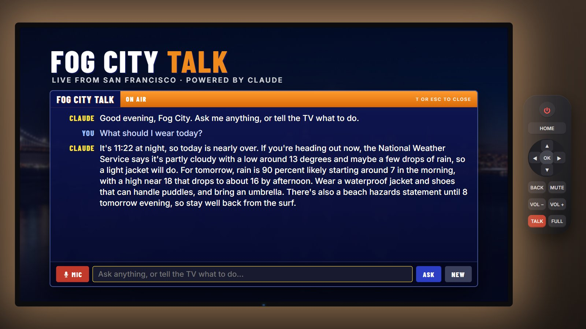
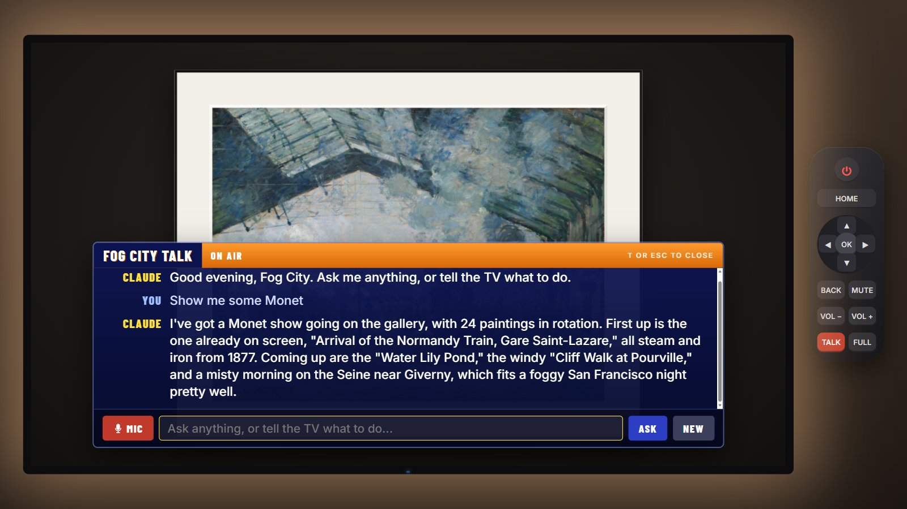
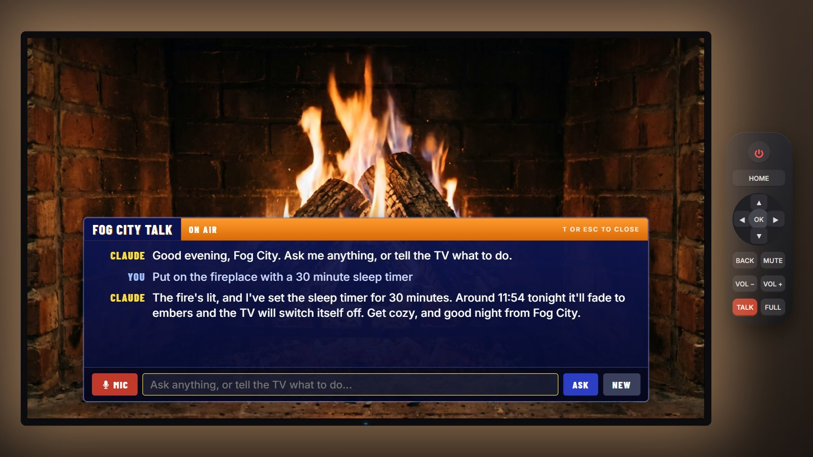
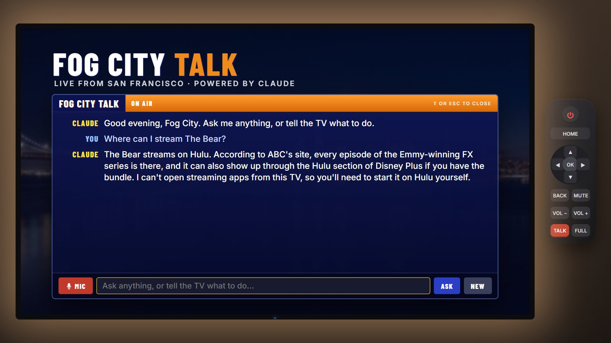

# Fog City TV: the development journey

This is how Fog City TV was built: a simulated smart TV in a web page with four channels (a 1990s weather station, an art gallery, a never-ending fireplace and Fog City Talk, a Claude channel that answers by voice and runs the TV). It covers the requirements, every API and open-source resource, how each graphic and sound was made, how fal was used and what it cost, the bugs found along the way, and what you need on Windows.

Everything was built in one day (2026-11-03) through conversation with Claude, working in Claude Code on the web. The author's laptop was attached for file access and, later, for running commands.

---

## 1. Inspiration and goal

The starting point was **[Tristen O'Brien's YouTube video](https://www.youtube.com/watch?v=-heT5C0oPg0)**. In it he uses Claude to build custom Android TV apps:

- a 1990s-style local weather channel with smooth jazz,
- an art gallery that shows public-domain paintings,
- a never-ending fireplace,
- a Claude chat channel on the TV.

The goal was to recreate the spirit of those channels **without an Android TV**, starting with three and adding the Claude channel at the end. The result had to be:

| Requirement | Decision |
|---|---|
| Runs without TV hardware | A web page that draws a TV, with an on-screen remote and keyboard control |
| Channels | Weather, Art Gallery and Fireplace first. The Claude chat channel was added later the same day as Fog City Talk (section 10). |
| City | San Francisco (the first draft assumed New York, and that was corrected) |
| Units | Celsius, km/h, hPa, km |
| Visual quality | Photorealism that matches or beats the video, using about $10 of fal credit for media |
| Branding | Original. The working name used the author's first name; it was later scrubbed and replaced with **Fog City**. |
| Infrastructure | A static site with no build step. Only Fog City Talk needs a backend, and it's a tiny proxy that holds the API key. |

### Why not run Claude with the subscription?

Early research checked whether a Claude Pro/Max subscription could power an in-TV Claude channel. It can't. Anthropic's terms limit subscription OAuth to Claude Code and Anthropic's own apps; third-party products must use an API key. Tristen used the API for the same reason. So **the subscription was used only to build the app** (Claude Code), and when the Claude channel was added it got its own API key with its own spend limit (section 10).

---

## 2. Process timeline

1. **Research.** Read the video transcript and redid Tristen's due diligence on each data source: terms, CORS, keys, rate limits. A research and plan document set out the phases.
2. **Style reference.** YouTube is blocked from the cloud sandbox, so the author downloaded the video locally with `yt-dlp`. Frames were then extracted with `ffmpeg` into contact sheets to study each channel's look.
3. **Media generation (fal).** Photoreal stills and video were made through the fal connector. The download script was run on the laptop because fal's CDN was also blocked from the sandbox.
4. **Asset preparation.** `ffmpeg` on the laptop made web-sized JPGs and a fast-start H.264 loop.
5. **Build.** Plain HTML, CSS and JavaScript ES modules: a shell and router, then the weather, fireplace and gallery modules.
6. **Automated testing.** Playwright drove headless Chromium twice: once with mocked NWS, radar and museum responses, and once with the network fully cut off to exercise the fallbacks. The runs produced screenshots, which were reviewed for layout bugs, and the bugs were fixed. More on this in section 8.
7. **Delivery.** The files were copied to the laptop with a `start.bat` launcher.
8. **Live run on the laptop.** This found two real-world problems that the sandbox couldn't reveal: the museum blocked requests coming from `localhost`, and some weather fields came back empty. Both were fixed (section 8).
9. **Rename, report and publish.** The personal name was removed, this report was written, and the site went to GitHub with GitHub Pages.
10. **Claude channel.** Fog City Talk was added with a key-holding proxy. It was tested first against a mock Claude, then live on the laptop, then tuned for cost (section 10).

---

## 3. Architecture

```
index.html          TV frame, power screen, on-screen remote; loads js/app.js
styles.css          room, TV bezel, CRT power-on, OSD, home, weather, fireplace and gallery styles
js/app.js           stage scaling (fixed 1920x1080 canvas scaled to fit), router, key map, shared Web Audio graph, OSD
js/home.js          home launcher: clock, weather chip, four app tiles
js/weather.js       weather station: NWS data, segment rotation, radar, sky cam, crawl, announcer
js/jazz.js          generative smooth-jazz engine (Web Audio)
js/icons.js         animated pixel-art weather icons on canvas, and NWS-text-to-icon classifier
js/fireplace.js     two-video crossfade loop, procedural crackle, sleep timer
js/gallery.js       AIC public-domain paintings, collections, mats, night dimming, settings menu
js/util.js          location constants, localStorage wrapper, fetch with timeout, solar elevation
js/talk.js          Fog City Talk: talk overlay and channel, voice in and out, Claude tool loop, TV tools
js/config.js        address of the public Claude proxy (empty = off the air)
server.py           local server: static files plus the /api/claude proxy (Python standard library only)
worker/worker.js    Cloudflare Worker version of the proxy, for the public site
assets/skycam/      six weather states of one fixed San Francisco view (JPG)
assets/fireplace/   fire.mp4 (10 s loop) and poster.jpg
tests/run.js        Playwright end-to-end test (mock and offline modes)
```

Design choices:

- **One fixed 1920x1080 stage** scaled with CSS `transform` to fit any window. Every layout is designed in TV pixels, so it looks identical on a phone or a 4K monitor.
- **Channels are classes** with `mount`, `unmount` and `onKey`. The router owns the remote. A channel returns `true` when it handles a key, and the shell handles Home, Back, volume and power.
- **One shared Web Audio graph**: each channel connects to a master gain, which goes through a compressor to the speakers. The power-on key press is the user gesture that unlocks audio, so autoplay policies are met.
- **Graceful degradation everywhere.** Weather falls back to labelled sample data, radar retries an alternate tile set, and the gallery falls back to the local sky-cam photos.
- **No dependencies**: no framework, no bundler, no npm packages at runtime.

---

## 4. APIs used (all free, no keys)

| API | Used for | Endpoint(s) | Terms |
|---|---|---|---|
| **National Weather Service** (`api.weather.gov`) | Current conditions, forecast, alerts | `/points/{lat},{lon}`, then the `forecast?units=si` link from it; `/stations/{id}/observations/latest`; `/alerts/active?point=` | US Government public domain. No NWS logos used and no endorsement implied. |
| **Iowa Environmental Mesonet** (Iowa State University) | Animated NEXRAD radar and the county/state base map | `mesonet.agron.iastate.edu/cache/tile.py/1.0.0/nexrad-n0q[-mXXm]/{z}/{x}/{y}.png`, `.../c/tile.py/1.0.0/uscounties`, `usstates` | Free public service built from NOAA NEXRAD data |
| **Art Institute of Chicago API** | Painting search and metadata | `api.artic.edu/api/v1/artworks/search` with `is_public_domain=true` | Data CC0. Only public-domain images are used. |
| **AIC IIIF image server** | The painting images | `www.artic.edu/iiif/2/{image_id}/full/1686,/0/default.jpg` | CC0 for public-domain works |
| **Web Speech API** (built into the browser) | The weather announcer | `speechSynthesis` | Uses your OS voices, such as Microsoft voices on Windows |
| **Web Audio API** (built in) | All music and sound effects | `AudioContext` | No audio files at all |
| **Google Fonts** | Barlow Condensed, Cormorant Garamond, Inter | `fonts.googleapis.com` | SIL Open Font License |

Notes from the build:

- **NWS observations.** Small stations often omit pressure, wind or visibility. The app fetches the four nearest stations in parallel. It takes the first one with a temperature and fills each missing field from the next station that reports it.
- **NWS asks for a User-Agent**, but browsers forbid setting one. In practice NWS answers browser requests with `Access-Control-Allow-Origin: *`, so no proxy was needed. This was checked live.
- **Refresh cadence**: weather every 10 minutes, radar every 5 minutes with a cache-buster, and the museum list cached for 7 days.

---

## 5. Open-source and free resources

- **Fonts**: [Barlow Condensed](https://fonts.google.com/specimen/Barlow+Condensed) (the 90s TV look), [Cormorant Garamond](https://fonts.google.com/specimen/Cormorant+Garamond) (gallery captions), [Inter](https://fonts.google.com/specimen/Inter) (UI). All three are under the OFL.
- **Playwright** (Apache-2.0): automated browser tests and screenshots.
- **ffmpeg** (LGPL/GPL): frame extraction and asset encoding.
- **yt-dlp** (Unlicense): downloading the reference video for frame study.
- **Python `http.server`** (PSF): the local static server.
- **Fontsource** (OFL): local copies of the fonts, used only for offline screenshot rendering.
- **NOAA solar position equations**, simplified, for sunset times, night detection and gallery dimming.

There are no runtime JavaScript libraries. Every visual and every sound is written from scratch in the repo.

---

## 6. How the graphics were made

### 6.1 Weather station look

- **Layout.** A blue gradient panel system inspired by 1990s cable weather channels: a top bar with the logo, segment title and clock, a main panel, and an orange "FOG CITY 24/7" tag on a scrolling crawl.
- **Logo.** A hand-written SVG: chrome-gradient italic "FOG CITY" over gold "WEATHER STATION", an orbit ellipse, and a sun, cloud and lightning bolt. All of it is vector, defined inline in `weather.js`.
- **Intro.** The logo flies in for about 4 seconds whenever the channel opens.
- **Segments** rotate every 12 to 16 seconds: Weather Alert (only when an alert is active), Current Conditions, Local Doppler Radar, Local Forecast, Extended Forecast, and the Fog City Sky Cam. Left and Right step through them by hand.
- **Weather icons.** Animated **pixel art drawn procedurally** on a 32x32 canvas and scaled up with `image-rendering: pixelated`. The sun rays rotate, rain falls, clouds drift and lightning flickers. At night the sun becomes a moon. A classifier maps NWS text such as "Slight Chance Rain Showers" to one of nine icon types.
- **Crawl.** Built from the active alerts, the next forecast periods and the sunset time, scrolling at a fixed pixel speed.

### 6.2 The radar map

The radar is built entirely in the browser from map tiles:

1. **Projection.** The Bay Area (centred at 37.75 N, 122.15 W) is converted to Web Mercator pixel coordinates at zoom 9. The app computes which 256-pixel XYZ tiles cover a 1840x780 panel.
2. **Base map.** IEM's US county and state line tiles are placed in a grid and recoloured to thin white lines with a CSS filter, on the blue panel.
3. **Precipitation.** IEM serves NEXRAD base reflectivity (`n0q`) composites as transparent PNG tiles for now and for every 5 minutes back to 55 minutes. The app preloads 12 frames and loops them every 420 ms, holding 1.8 s on the latest frame, with a timestamp box.
4. **Labels.** City names are placed with the same Mercator maths, with San Francisco highlighted. A dBZ colour legend and a credit line finish the panel.
5. **Fallback.** If the main tile set fails, it retries IEM's `-900913` tile variant.

### 6.3 Sky cam (photoreal, made with fal)

There are six images of **one fixed camera view** from Treasure Island across the bay to the San Francisco skyline and Bay Bridge: sunny, overcast, fog, rain, thunderstorm and clear night.

- The current NWS condition and the sun's elevation pick the image. A daytime image is dimmed with a filter at night.
- A slow Ken Burns zoom adds motion.
- A canvas particle overlay adds falling rain, snow or drifting fog to match the live weather.
- In storms, CSS lightning flashes light up the sky cam.

The view is the same in all six, so changes in the weather crossfade smoothly. Section 7 explains how this was done.

### 6.4 Home screen

The home screen is pure CSS: a synthwave sunset with striped sun bands, an animated perspective grid, a large clock and date, and a live weather chip. Each app tile shows a live preview:

- **Weather**: the current sky-cam image.
- **Art Gallery**: the last painting shown.
- **Fireplace**: the muted fire video.
- **Fog City Talk**: a microphone on a blue studio glow, with a blinking red on-air light.

### 6.5 Art gallery

- **Paintings** come from AIC search queries, filtered to public-domain paintings with an image.
- **Collections**: This Season (by month, for example "autumn harvest" in November), All Works, Landscapes, Coastal, Botanical, City Life and Abstract.
- **Frame**: a matted frame with a bevel, a canvas texture and a soft wall shadow. There are 9 mat colours (two with gold fillets) and 5 mat sizes, previewed live in a menu.
- **Captions** fade in for 9 seconds with the title, artist and date.
- **Night dimming** follows the solar elevation: 70% brightness after sunset, 50% after civil twilight.
- **Settings persist** in `localStorage`.

---

## 7. fal: how it was used, and what it cost

fal was used **only at build time**, through Claude's fal connector, which runs the models from inside the conversation. The site contains no fal key and makes no fal calls.

### 7.1 Sky cam

1. **Base image** with `fal-ai/nano-banana-pro` (Google's Nano Banana Pro) at 2K, 16:9. The prompt described a webcam-style wide shot of the San Francisco skyline from Treasure Island on a clear afternoon: Transamerica Pyramid, Salesforce Tower, the Bay Bridge entering from the left, a locked-off 24 mm camera, and no text.
2. The first result looked like a real webcam frame, including a fake timestamp strip and a vignette.
3. **Six weather variants** with `fal-ai/nano-banana-pro/edit`, all from that base image. Each prompt began with *"Keep the exact same camera position, framing, skyline, bridge and water. Remove the timestamp text strip and the vignette"*, then described one weather state:
   - classic SF advection fog swallowing the top of the Salesforce Tower,
   - a thunderstorm at dusk with a forked bolt behind the skyline,
   - a clear night with the Bay Bridge cable lights,
   - and so on for the other three.

   Editing one base image, instead of generating six separate images, keeps the camera framing identical, so the images crossfade cleanly.

### 7.2 Fireplace

1. **Still** with `fal-ai/nano-banana-pro` at 2K: a straight-on, tripod-locked shot of an aged red-brick firebox, three split oak logs in a teepee on a cast-iron grate, a deep ember bed, firelight as the only light source, and no text.
2. **Video**: two image-to-video models were run side by side on the same still, each for 10 seconds:
   - `fal-ai/kling-video/v3/pro/image-to-video` (Kling 3.0 Pro), with **the same image as both the start frame and the end frame**. The clip therefore begins and ends on the same picture, which is the key to a loop with no visible seam. Settings: negative prompt "camera movement, zoom, pan, slow motion, floating flames, morphing logs…", `cfg_scale` 0.5, no audio.
   - `alibaba/wan-3.0-prime/image-to-video` (Wan 3.0) at 1080p, as a comparison.
3. **Selection.** The two loops were compared on how closely the last frames match the first (frame similarity at the loop point) and on how natural the motion looked. Kling won and became the loop. Wan stayed as a backup.
4. **Encoding** with ffmpeg: 1920x1080, H.264 CRF 20, `+faststart` so playback starts before the download finishes, and the audio stripped. The result is 3.7 MB.

### 7.3 Making it never-ending

- **Picture.** Two `<video>` elements play the same clip. 0.6 s before the end of one, the other starts from frame 0 and fades in while the first fades out. Combined with Kling's matching first and last frames, no loop point is visible.
- **Sound** is procedural Web Audio, not a recording, so it never repeats:
  - a **roar** bed (23 s of brown noise through a low-pass filter whose level and cutoff slowly "breathe"),
  - a **hiss** bed (29 s of white noise through a high-pass filter).
  - The bed lengths are coprime, so together they repeat only every 23 x 29 = 667 seconds.
  - **Crackles** follow a Poisson process (about 7 per second, with occasional clusters). Each is a burst of noise through a band-pass filter, with random pitch, Q, length and stereo position.
  - **Pops** about every 5 seconds on average.
  - A **"log settles"** event every 1 to 3 minutes: a low thump, crumbling embers and a burst of crackles.
- **Controls.** Up and Down set the crackle level. OK opens a **sleep timer** (30 min, 1 hr or 2 hr). Over its last minute the picture and sound fade out, then the TV switches off.

### 7.4 Cost

| Item | Model | Unit price | Qty | Cost |
|---|---|---|---|---|
| Fireplace still (2K) | nano-banana-pro | $0.15 per image | 1 | $0.15 |
| Sky cam base (2K) | nano-banana-pro | $0.15 per image | 1 | $0.15 |
| Sky cam weather variants (2K) | nano-banana-pro/edit | $0.15 per image | 6 | $0.90 |
| Fire loop, 10 s, used | Kling 3.0 Pro i2v | $0.14 per second | 10 s | $1.40 |
| Fire loop, 10 s, comparison | Wan 3.0 Prime i2v | $0.05 per second | 10 s | $0.50 |
| **Total fal spend** | | | | **about $3.10** of a $10 credit |

Other costs:

- **Claude**: built inside an existing Claude subscription (Claude Code). No API credits were used.
- **Runtime data**: $0. NWS, IEM and AIC are free and keyless.
- **Hosting**: $0 on GitHub Pages, or run it locally.

### 7.5 Rights

- fal's terms give the account holder the outputs of these models. The generated images and video in `assets/` are included in this repo for that reason.
- Museum images are **not** stored in the repo. They are fetched at run time from AIC and are limited to public-domain (CC0) works.

---

## 8. Problems found, and how they were solved

| Problem | Cause | Fix |
|---|---|---|
| YouTube and fal CDN unreachable from the cloud sandbox | Sandbox egress policy | The video was downloaded on the laptop with yt-dlp. A `download_assets.sh` script fetched the fal outputs on the laptop. |
| The first sky-cam base had a fake timestamp and a vignette | The "webcam-style" prompt was taken literally | Every edit prompt also removed them |
| The extended forecast said "THI" for "This Afternoon" | Day names were cut to their first 3 letters | "Today", "This Afternoon" and "Tonight" now map to TODAY |
| Condition text overlapped "CELSIUS" | Long NWS phrases such as "Thunderstorms and Rain" | The text box has a fixed width, and long words shrink the font |
| "Oakland" label overlapped "San Francisco" on the radar | The cities are 13 km apart at zoom 9 | Each label can now have its own vertical offset |
| The lightning flash washed out the whole TV | The flash covered the full screen | The flash is now confined to the sky-cam panel, at lower opacity |
| The sun icon in the logo collided with the text | SVG layout | The sun group was moved and scaled |
| **The gallery showed no paintings in a real browser** (the sandbox tests had passed) | AIC's Cloudflare returns **403** to requests whose `Referer` is `localhost` or `127.0.0.1`. The browser reported this as a CORS error, because a 403 page has no CORS header. | `<meta name="referrer" content="no-referrer">` in `index.html`. Verified live: real paintings loaded (the first was George Inness, *Harvest, Montclair, New Jersey*, 1884). AIC also blocks headless browsers, so test screenshots of the gallery use a visible browser. |
| **Pressure and wind showed N/A in live data** | The San Francisco Downtown station doesn't report them | Fetch the nearest four stations and fill each missing field from the next one that has it |
| Claude channel: one news question used 36,000 input tokens (about 16 cents) | The `web_search_20260209` tool filters results by running code on Anthropic's side, which took 5 model turns | Switched to the plain `web_search_20250305` tool with at most 2 searches: 13,000 tokens, about 7 cents |
| "Show me some Monet" showed a different painting from the one Claude named | Opening the gallery starts its seasonal collection loading. When Claude's search finished first, the slower seasonal image arrived later and covered the Monet. | Each `show()` call gets a sequence number, and an image that loads after a newer one was requested is dropped |
| Claude channel couldn't be tested live from the cloud sandbox | The sandbox and the laptop's Cowork VM both block `api.anthropic.com` | Tested against a mock Claude in the sandbox, then live on the laptop through a remote session |
| The local server stopped unexpectedly when started remotely | Process lifetime tied to the remote session | Use `start.bat`, which you run yourself |

Testing used [`tests/run.js`](../tests/run.js). It steps through power-on, home, every weather segment, the fireplace and its sleep timer, and the gallery with its mat menu, plus a phone-sized viewport. It runs in two modes:

- `mock`: deterministic fake NWS, radar and museum responses, including a thunderstorm and a Wind Advisory.
- `offline`: every external host is blocked.

Both modes must finish with no page errors.

---

## 9. Requirements and dependencies on Windows

### To run it

| Need | Details |
|---|---|
| Windows 10 or 11 | Any edition |
| A modern browser | **Chrome or Edge** (recommended). Firefox works. The page uses ES modules, Web Audio, `speechSynthesis` and the Fullscreen API. |
| A local web server | Needed because the browser won't load ES modules from `file://`. **Python 3** runs `server.py` through `start.bat`, and that's required for Fog City Talk. For the other channels any static server works: **Python 3** (`python -m http.server 8080`; install from python.org or the Microsoft Store), **Node.js** (`npx serve -l 8080`), or VS Code's **Live Server** extension. |
| Internet access | For live weather, radar, paintings and fonts. Without it, the TV still runs with sample weather and the local photo gallery. |
| Speakers | For the jazz, the announcer and the crackle. Windows' built-in voices (for example Microsoft David or Zira) speak the announcer lines. |

Or skip all of that and **play it on GitHub Pages**. Nothing to install.

### To develop and test it

| Tool | Why |
|---|---|
| Git for Windows (includes Git Bash) | Version control, and running `.sh` helper scripts |
| Node.js 18 or later, plus Playwright (`npm i -D playwright`, then `npx playwright install chromium`) | Running `tests/run.js` |
| ffmpeg (`winget install Gyan.FFmpeg`) | Re-encoding the video and resizing images if you replace assets |
| yt-dlp (`winget install yt-dlp`) | Only for studying reference videos |
| A fal account (optional) | Only to regenerate the photoreal media |

## 10. Fog City Talk: how the Claude channel works

Fog City Talk puts Claude on the TV. You press **T** (or the red TALK button), speak or type, and Claude answers on screen and out loud. It can also run the TV: change channels, set the fireplace sleep timer, find paintings, change the volume and read the live forecast. Setup, security and cost for users are in [CLAUDE-CHANNEL.md](CLAUDE-CHANNEL.md). This section explains how it works inside.

### 10.1 API, not subscription, and not Claude Code

The channel calls the **Claude API** (the Messages API at `api.anthropic.com/v1/messages`) with an API key from the Claude Console. The key is billed per token, in a workspace that has its own monthly spend limit. Claude Code was only the tool that wrote the code. The Claude app subscription can't power a third-party app (section 1).

### 10.2 The request path

```
 microphone --> browser speech recognition --> text
                                               |
 js/talk.js builds {system, messages, tools} --+--> POST /api/claude (server.py on the laptop,
                                                    or the Cloudflare Worker for the public site)
                                                         |
                                  proxy adds the key, fixes model and limits
                                                         |
                                                         v
                                             api.anthropic.com/v1/messages
                                                         |
 speechSynthesis <-- text blocks <-- js/talk.js <-- JSON response
                                       |
                                       +-- tool_use blocks --> run on the TV --> tool_result --> POST again
```

The page never has the key. It sends only what the conversation needs:

```json
{
  "system": "You are the host of Fog City Talk ... Right now: <date and time> in San Francisco. The TV is on the gallery channel. On screen: \"Water Lilies\" by Claude Monet, 1906 ...",
  "messages": [ {"role": "user", "content": "Who painted this?"} ],
  "tools": [ {"name": "switch_channel", ...}, {"name": "set_sleep_timer", ...}, ... ]
}
```

The proxy (`server.py` or `worker/worker.js`) checks the request and builds the real API call. The page doesn't choose any of these settings:

| Field | Value | Why |
|---|---|---|
| `model` | `claude-opus-5-5` | Anthropic's current default model |
| `max_tokens` | 2048 | Spoken answers are short. This is a hard cap per reply. |
| `output_config.effort` | `low` | Less thinking, so faster and cheaper chat answers |
| `tools` | the page's custom tools, plus `web_search_20250305` with `max_uses: 2` | Only custom tools are accepted from the page, so it can't add costly server tools |
| `fallbacks` | `"default"` (beta `server-side-fallback-2026-07-01`) | If a safety classifier declines a request, the API retries it on a fallback model by itself |

So even a modified page can't switch to a more expensive model or ask for longer answers.

### 10.3 Tool use: how Claude runs the TV

Claude can't touch the page. It can only *ask* for an action, and the page carries it out. Each tool is a name, a description and a JSON schema:

| Tool | What the page does |
|---|---|
| `switch_channel {channel}` | `tvApp.go(channel)` |
| `set_sleep_timer {minutes}` | Switches to the fireplace and calls its `setSleep(minutes)` |
| `show_art {query}` | Switches to the gallery and searches the Art Institute of Chicago API, then returns the titles found so Claude can name them |
| `set_volume {level, mute}` | Sets the shared Web Audio master gain |
| `get_forecast {}` | Fetches the NWS forecast and alerts in Celsius and returns them as text |

One exchange, as it ran in the live test:

1. Page sends: *"Put on the fireplace, then say goodnight."*
2. Claude replies with `stop_reason: "tool_use"` and one block, `tool_use switch_channel {"channel":"fireplace"}`. That reply used 471 input tokens and 53 output tokens.
3. The page switches to the fireplace. It then adds Claude's whole reply to the conversation, adds a `tool_result` saying "Now on the fireplace channel", and sends the conversation again.
4. Claude replies with `stop_reason: "end_turn"` and the goodnight text, which the page shows and speaks.

The loop runs at most 6 rounds per question. Two rules keep it correct:

- **The conversation is append-only.** Claude's full reply goes back unchanged, including its `thinking` blocks and search results. Current models check that earlier turns haven't been edited, so the page never rewrites history. It only starts fresh: when you press NEW, after about 20 exchanges, or after an error partway through a tool round.
- **Every `stop_reason` is handled.** `tool_use` runs the tools. `pause_turn` (a long server-side search) sends the conversation back so Claude can continue. `refusal` shows a polite line and resets. `end_turn` speaks the answer. The answer can come split into several `text` blocks (it splits wherever search citations attach), so the page joins all of them.

### 10.4 Web search

`web_search` is a **server tool**. Anthropic runs the search during the same API call, and the results come back as `server_tool_use` and `web_search_tool_result` blocks next to the answer. The page only shows the text. A search costs $10 per 1,000 searches, plus the tokens of the results Claude reads.

The first version used the newer `web_search_20260209`, which filters results by running code on Anthropic's side. One live news question then took 5 model turns, 4 code runs and 2 searches, and used **36,041 input tokens**, about 16 cents. The plain `web_search_20250305` with at most 2 searches answered the same question in 2 turns and 1 search with **13,413 input tokens**, about 7 cents. For one-sentence TV answers the filtering wasn't worth it, so the channel uses the plain tool.

### 10.5 Voice

- **Speech in:** the browser's Web Speech API (`SpeechRecognition`, which Chrome and Edge provide). The browser sends the audio to its own speech service (Google for Chrome, Microsoft for Edge) and returns text. Firefox doesn't support it, so the text box is always there.
- **Speech out:** `speechSynthesis` with an installed English voice, the same engine as the weather announcer. Markdown and URLs are stripped before speaking, and the system prompt asks for plain spoken sentences.

### 10.6 Keeping the key and the bill safe

| Layer | Protection |
|---|---|
| Repository | The key isn't in it. `.anthropic_key`, `.env` and `.dev.vars` are git-ignored. `js/config.js` ships with no proxy address, so the public site shows **Off the air**. |
| Local proxy (`server.py`) | Listens on 127.0.0.1 only. Refuses to serve dotfiles or its own source. Allows 300 requests a day. |
| Public proxy (Worker) | The key is a Cloudflare secret. Only the site's own origin is accepted, plus a passcode. Optional daily cap stored in KV. |
| Request shape | The proxy fixes the model, the effort and the token cap, and accepts only custom tools |
| Console | A dedicated workspace with a monthly spend limit ($20) stops everything at a dollar ceiling. The promo credit expires 2026-11-11. |

Measured costs: a TV command is under 2 cents, and a question that needs a web search is about 7 cents.

### 10.7 How it was tested

1. **Mock Claude in the sandbox.** A fake upstream returned a `tool_use` and then text. Playwright checked that the TV switched to the fireplace and showed the 30-minute timer. It also checked that typing H, M, T or F in the talk box doesn't trigger TV shortcuts, and that the request sent upstream had the right model, headers and tool list.
2. **Worker logic in Node** with a mocked `fetch`: wrong origin gives 403, missing passcode gives 401, the daily cap gives 429, and the CORS preflight gives 204.
3. **Live on the laptop.** The cloud sandbox can't reach `api.anthropic.com`, so the real calls ran on the laptop through `server.py`: a tool call, a web search question, then the comparison in 10.4.
4. **Screenshots** of real answers were taken in a visible Edge window (the museum blocks headless browsers).

| Weather advice | Painting search |
|---|---|
|  |  |

| Fireplace with sleep timer | Where to stream a show |
|---|---|
|  |  |

---

## 11. Ideas for next steps

- **Your own city.** Change `PLACE` in `js/util.js` and regenerate the six sky-cam states with the prompts in section 7.
- **Live sky cam.** Swap the photos for a public webcam stream where its licence allows.
- **Hourly forecast and a temperature graph segment** from the NWS `forecastHourly` endpoint.
- **More museums.** Add Cleveland Museum of Art Open Access or the Met Open Access as more CC0 sources.
- **A real TV.** Install the page as a PWA, or cast it to an Android TV or Chromecast in kiosk mode.
- **Stream Claude's answers** so the first words appear and are spoken sooner.
- **Let Claude see the painting** by sending the on-screen image with the question.
- **A wake word**, so you can say "Hey Fog City" without pressing a button.
